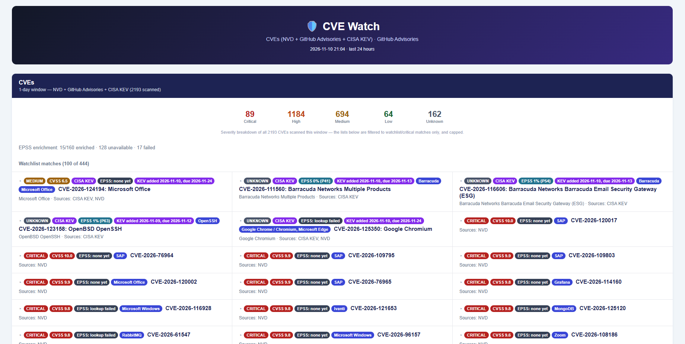

# CVE Watch



CVE Watch is an automated digest that aggregates vulnerability data from NVD, GitHub Security Advisories, and CISA KEV, filters it against an editorial watchlist of ~150 products, and renders the result as a self-contained HTML page with collapsible entries.

## Core Functionality

CVEs are merged from three sources: NVD (hour-precision), GitHub Security Advisories and CISA KEV (day-precision). Only CVEs matching the watchlist, or rated critical/KEV, are shown. NVD alone can list hundreds of CVEs a day, most of them irrelevant, so an unfiltered dump would bury the signal. Each shown CVE is enriched with an EPSS score (probability of exploitation in the next 30 days, from `cvedb.shodan.io`) where available, plus the CISA KEV added/due dates when applicable.

GitHub Advisories get their own section, separate from the CVE one above: GitHub publishes plenty of advisories (especially npm/pip/go/etc. packages) that never get a CVE assigned at all, so they'd otherwise be invisible. Only critical/high severity or a watchlist match is shown, and any advisory whose CVE is already shown in the CVE section is excluded to avoid duplicates.

## Resilience Features

Every source is fetched through its own try/except in `main()`: one source failing never takes the others down with it, and the error is surfaced at the top of the page instead of silently swallowed. Built-in retry logic (3 attempts, delay doubling) handles transient failures. No state file: each run is self-contained and just looks back `--hours` hours. If nothing new turned up anywhere and nothing errored, no file is written; if every source came up empty but at least one of them errored, a file is still written so a quiet day and an outage don't look the same from the folder.

Entries render as collapsed rows (title + badges only) to keep a long list scannable. Click one to expand its full description. A 3-column grid packs more entries on screen without crowding.

---

## Sources

| Source | Role |
|---|---|
| [NVD](https://services.nvd.nist.gov/rest/json/cves/2.0) | Primary CVE feed, hour-precision |
| [GitHub Security Advisories](https://github.com/advisories) | CVE enrichment + its own non-CVE section |
| [CISA KEV](https://www.cisa.gov/known-exploited-vulnerabilities-catalog) | Known-exploited flag, day-precision |
| [Shodan CVEDB](https://cvedb.shodan.io) | EPSS exploitation-probability score |

---

## Setup

### 1. Install dependencies

```bash
pip install -r requirements.txt
```

### 2. Run

```bash
# Last 24 hours (default)
python cve_watch.py

# Custom lookback window, in hours (1–720)
python cve_watch.py --hours 7
```

Output is a single timestamped file: `cve_watch_YYYY-MM-DD_HHMM.html`.

---

## Project Structure

```
CVE_Watch/
├── cve_watch.py     # Everything: fetch, filter, enrich, render
├── requirements.txt
├── run_6h.bat        # Scheduled wrapper (--hours 6, logs to _logs/)
├── run_now.bat        # Manual on-demand run (--hours 24, visible console)
├── run_hidden.vbs     # Launches run_6h.bat with no console window
└── _logs/             # Per-day run logs (gitignored)
```

---

## Configuration Reference

Editorial constants live directly in `cve_watch.py`:

| Constant | Default | Description |
|---|---|---|
| `PRODUCTS` | ~150 entries | Watchlist: product label → matching aliases (word-boundary matched) |
| `CVE_WATCHED_CAP` | `100` | Max watchlist-matched CVEs shown |
| `CVE_CRITICAL_CAP` | `60` | Max critical/KEV CVEs shown |
| `GHSA_CAP` | `60` | Max GitHub Advisories shown |
| `GHSA_SHOW_SEVERITIES` | `{critical, high}` | Severities shown regardless of watchlist match |
| `NVD_PAGE_SIZE` / `NVD_MAX_PAGES` | `200` / `20` | NVD pagination (throttles on large unauthenticated pages) |
| `GHSA_MAX_PAGES` | `10` | GitHub Advisories pagination (both the CVE-linked fetch and the standalone section) |

### Adding a watchlist entry

```python
PRODUCTS = {
    "My Product": ("my product", "myproduct alias"),
    # ...
}
```

---

## Scheduling (Windows)

Runs automatically every 6 hours via Task Scheduler, launched hidden through `run_hidden.vbs` (so no console window flashes up):

```
Program  : wscript.exe
Arguments: C:\path\to\CVE_Watch\run_hidden.vbs
Trigger  : Every 6 hours
```

`run_now.bat` is for ad-hoc manual runs (visible console, 24h window, pauses on exit).

---

## Known Limitations

- **Watchlist matching is mostly text-based.** NVD entries get a clean vendor/product signal parsed out of their CPE data when available, but GitHub Advisories, CISA KEV, and any NVD entry published without CPE data yet still rely on word-boundary matching against the title/description text. A legitimate but ambiguous product name can still mismatch.
- **Source lag.** NVD, GHSA, and CISA KEV each publish on their own schedule; a CVE can appear in one source hours or days before another. EPSS scores (from `cvedb.shodan.io`) commonly aren't available yet for very recent CVEs; this shows as an explicit "EPSS: none yet" badge rather than a missing one.
- **Pagination caps.** NVD stops after `NVD_MAX_PAGES` pages and GitHub Advisories after `GHSA_MAX_PAGES`; both are generous backstops sized against real high-volume days, not a guarantee against every possible one. If NVD's cap is hit with more results still available, this is reported as a source error on the page rather than failing silently.
- **Severity counts reflect everything scanned, not just what's shown.** The per-severity tile row covers all CVEs seen in the window; the lists below it are filtered to watchlist/critical matches and capped.
